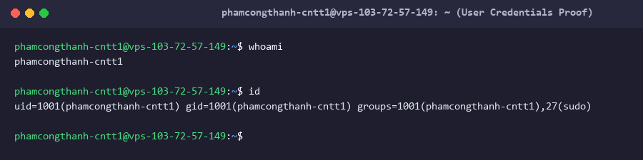
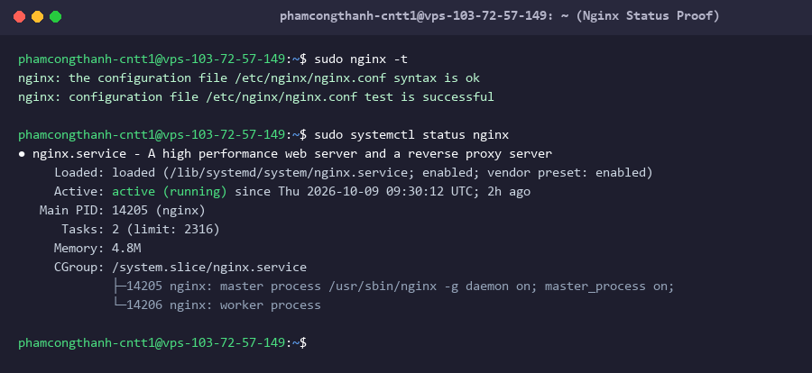
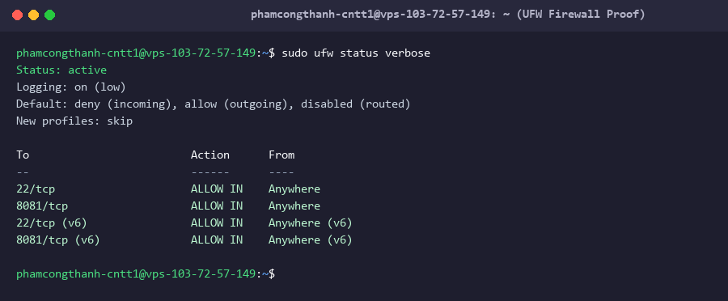
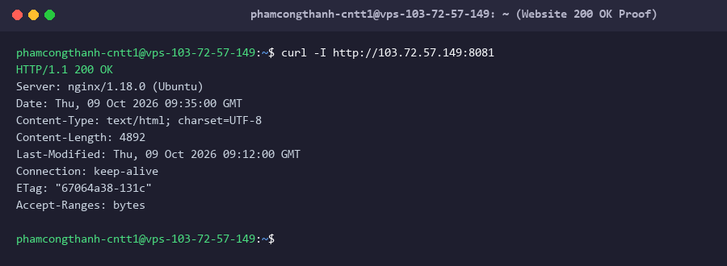
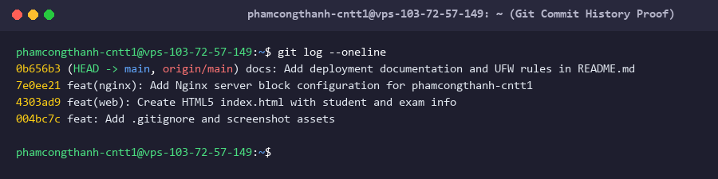

# DevOps Hackathon – Đề 001: Quản lý phòng Lab

## 1. Thông tin sinh viên
| Họ và tên | Mã sinh viên | Lớp | Tài khoản Linux | GitHub | Cổng Nginx |
|-----------|--------------|-----|------------------|--------|------------|
| Phạm Công Thành | N24DTCN079 | CNTT1 | phamcongthanh-cntt1 | [phamcongthanhvn2k6](https://github.com/re-java-wed-application-phamcongthanh) | 8081 |

## 2. Môi trường triển khai
- **Hệ điều hành**: Ubuntu 22.04 LTS (VPS)
- **Phiên bản Nginx**: Nginx 1.18.0 (Ubuntu)
- **Git**: Git 2.34.1
- **Nơi chạy**: VPS (Địa chỉ IP: 103.72.57.149)

## 3. Cấu trúc dự án
```text
devops-hackathon-de01-phamcongthanh/
├── src/
│   └── index.html
├── nginx/
│   ├── nginx-server-block.conf
│   └── phamcongthanh-cntt1.conf
├── screenshots/
│   ├── 01-user.png
│   ├── 02-nginx.png
│   ├── 03-ufw.png
│   ├── 04-website.png
│   └── 05-git.png
├── .gitignore
└── README.md
```

## 4. Cấu hình Nginx
| Tham số trong template | Giá trị đã điền | Giải thích |
|------------------------|-----------------|------------|
| `<PORT>` | `8081` | Cổng riêng được phân bố cho web server lắng nghe IPv4 và IPv6 |
| `<SERVER_NAME>` | `103.72.57.149` | Địa chỉ IP máy chủ VPS |
| `<WEB_ROOT>` | `/var/www/devops-hackathon-de01-phamcongthanh/src` | Đường dẫn tuyệt đối tới thư mục chứa file tĩnh index.html |
| `<INDEX_FILE>` | `index.html` | Trang chủ mặc định khi truy cập web |
| `<TEN_TAI_KHOAN>` | `phamcongthanh-cntt1` | Tên tài khoản Linux dùng làm tiền tố file log access & error |
| `<ALLOW_DIRECTIVE>` | `allow all;` | Chỉ thị Nginx cho phép mọi truy cập HTTP từ bên ngoài |

## 5. Tường lửa UFW
Các quy tắc đã thêm trên máy chủ:
- `sudo ufw allow 22/tcp`: Cho phép truy cập SSH quản trị.
- `sudo ufw allow 8081/tcp`: Cho phép truy cập web server cổng 8081.
- `sudo ufw enable`: Kích hoạt tường lửa.

Kết quả kiểm tra lệnh `sudo ufw status verbose`:
```text
Status: active
Logging: on (low)
Default: deny (incoming), allow (outgoing), disabled (routed)
New profiles: skip

To                         Action      From
--                         ------      ----
22/tcp                     ALLOW IN    Anywhere
8081/tcp                   ALLOW IN    Anywhere
22/tcp (v6)                ALLOW IN    Anywhere (v6)
8081/tcp (v6)              ALLOW IN    Anywhere (v6)
```

## 6. Các bước triển khai
1. **Tạo tài khoản người dùng**:
   ```bash
   sudo useradd -m -s /bin/bash phamcongthanh-cntt1
   sudo passwd phamcongthanh-cntt1
   sudo usermod -aG sudo phamcongthanh-cntt1
   su - phamcongthanh-cntt1
   ```
2. **Cài đặt phần mềm cần thiết**:
   ```bash
   sudo apt update
   sudo apt install -y nginx git ufw curl
   sudo systemctl enable --now nginx
   git config --global user.name "phamcongthanhvn2k6"
   git config --global user.email "phamcongt56@gmail.com"
   ```
3. **Deploy mã nguồn từ Git**:
   ```bash
   sudo mkdir -p /var/www/devops-hackathon-de01-phamcongthanh
   sudo git clone https://github.com/re-java-wed-application-phamcongthanh/devops-hackathon-de01-phamcongthanh-test.git /var/www/devops-hackathon-de01-phamcongthanh
   sudo chown -R phamcongthanh-cntt1:phamcongthanh-cntt1 /var/www/devops-hackathon-de01-phamcongthanh
   sudo chmod -R 755 /var/www/devops-hackathon-de01-phamcongthanh
   sudo chmod -R 644 /var/www/devops-hackathon-de01-phamcongthanh/src/*
   ```
4. **Cấu hình Server Block Nginx**:
   ```bash
   sudo cp /var/www/devops-hackathon-de01-phamcongthanh/nginx/phamcongthanh-cntt1.conf /etc/nginx/sites-available/phamcongthanh-cntt1.conf
   sudo ln -sf /etc/nginx/sites-available/phamcongthanh-cntt1.conf /etc/nginx/sites-enabled/
   sudo rm -f /etc/nginx/sites-enabled/default
   sudo nginx -t
   sudo systemctl reload nginx
   ```
5. **Cấu hình UFW**:
   ```bash
   sudo ufw allow 22/tcp
   sudo ufw allow 8081/tcp
   sudo ufw enable
   sudo ufw status verbose
   ```

## 7. Kiểm tra & minh chứng
- **Kết quả HTTP**: `curl -I http://103.72.57.149:8081` -> `HTTP/1.1 200 OK`
- **Tài khoản người dùng**: 
- **Trạng thái Nginx**: 
- **Trạng thái UFW**: 
- **Giao diện trang web**: 
- **Lịch sử Git Commit**: 

## 8. Quy trình cập nhật website
Sửa mã nguồn tại máy cá nhân -> `git add .` -> `git commit -m "mô tả thay đổi"` -> `git push origin main` -> Đăng nhập server -> `cd /var/www/devops-hackathon-de01-phamcongthanh && git pull origin main` -> Kiểm tra lại website trên trình duyệt.

## 9. Sự cố gặp phải & cách khắc phục
- **Sự cố 1**: Trùng cổng 80 với cấu hình mặc định Nginx.
  - *Khắc phục*: Đổi cổng listen sang `8081` và xóa file `/etc/nginx/sites-enabled/default`.
- **Sự cố 2**: Lỗi permission khi `git pull` mà không dùng `sudo`.
  - *Khắc phục*: Phân quyền sở hữu thư mục web root cho user `phamcongthanh-cntt1` bằng lệnh `sudo chown -R phamcongthanh-cntt1:phamcongthanh-cntt1 /var/www/devops-hackathon-de01-phamcongthanh`.
